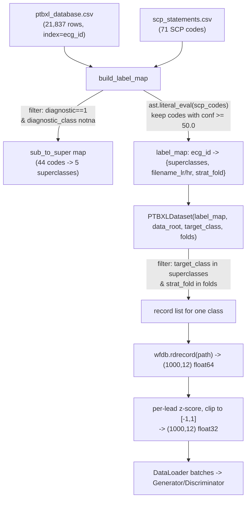
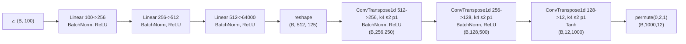
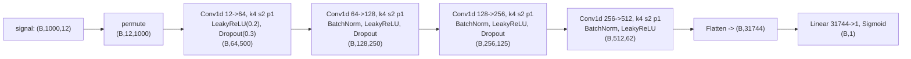
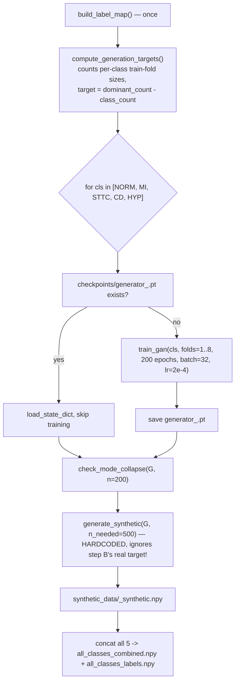
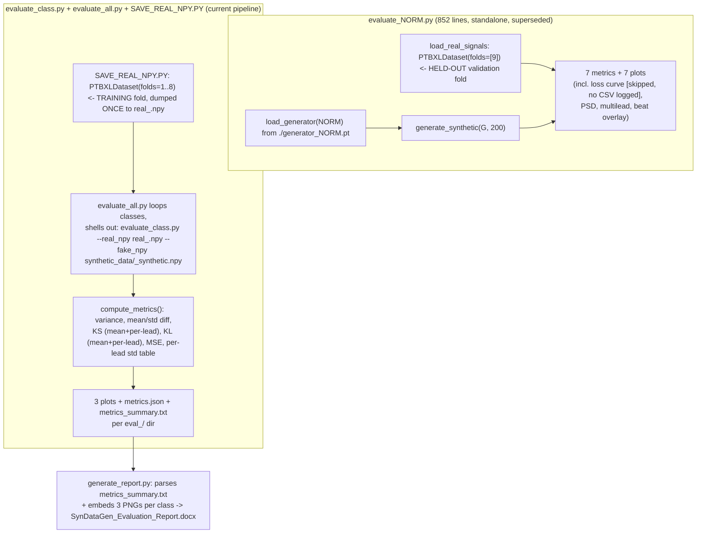
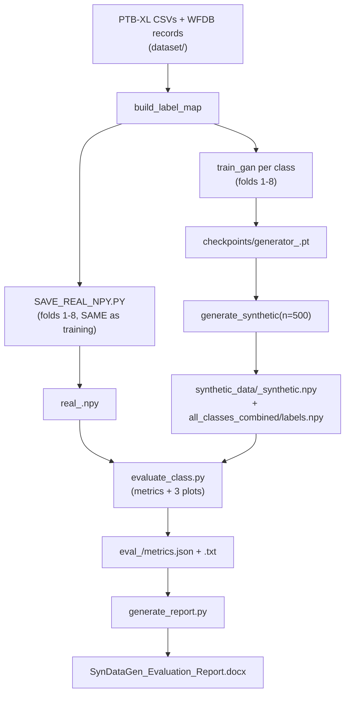

# SynGen Codebase Analysis — Context Document

**Subject:** `syngen/SynGen/SynGen/` (untracked in git as of this writing — `git status` shows `?? syngen/`)
**Purpose:** This is the Stage-0 audit deliverable called for by `ml/TODO.md` **Phase A** ("the original codebase, arriving separately"). `docs/ml_architecture.md` and `ml/README.md` explicitly defer all dataset/model/training/eval decisions until this audit exists. This document *is* that audit, read line-by-line, so any future session (human or agent) can act on it without re-reading the raw code.
**How to use this doc:** Section 12 ("Critical Findings") is the part that changes what you do next — read it first if you're short on time. Sections 5–10 are the detailed walkthrough. Section 15 maps everything onto `ml/interfaces.py` for Phase B.

---

## 1. What this codebase actually is

A **from-scratch DCGAN-style generator for synthetic 12-lead PTB-XL ECGs**, trained separately per diagnostic superclass (`NORM`, `MI`, `STTC`, `CD`, `HYP`), plus a hand-rolled evaluation/reporting toolchain that produces a `.docx` comparison report. It is a **flat collection of standalone scripts** (no package, no `__init__.py`, no tests, no config files, no `requirements.txt`) that was clearly built incrementally across two sessions (late March 2026 and mid-September 2026), each apparently assisted by a different LLM session that didn't have full visibility into the other's work — see Section 13.

It is **not** a patient-schema / multimodal pipeline. It only touches ECG waveform generation, one modality out of the many `SysDaG_Project_Spec` calls for. It should be treated as a candidate implementation for the future `generation/` layer (per `CLAUDE.md` §4/§5) and as a worked example of PTB-XL loading that the ingestion layer can crib from — not as ingestion/schema/validation code itself.

---

## 2. Directory map (code vs. generated artifacts)

```
syngen/SynGen/SynGen/
├── gan_pytorch.py                 ← CORE: label map, Dataset, Generator, Discriminator, train/generate/eval helpers
├── gan_pytorch2.py                ← ORPHAN: unused reconstruction of Generator/Discriminator (see §13)
├── generate_ecg_all_classes.py    ← actually contains "train_all_classes.py" (trains all 5 GANs, generates+combines)
├── SAVE_REAL_NPY.PY               ← dumps real_<CLASS>.npy from PTB-XL, TRAINING folds only (see §12.1)
├── evaluate_NORM.py               ← legacy monolithic eval script (7 plots, uses held-out fold 9) — superseded
├── evaluate_class.py              ← current generalized per-class eval script (3 plots + metrics.json)
├── evaluate_all.py                ← shells out to evaluate_class.py once per class via os.system
├── generate_report.py             ← reads eval_<CLASS>/metrics_summary.txt + pngs → SynDataGen_Evaluation_Report.docx
├── visualize.py                   ← actually the single generator_NORM.pt quick-plot script (see §13)
├── visualize2.py                  ← actually the argparse-based all-classes plotting script (see §13)
├── test.ipynb                     ← exploratory notebook: wfdb load + plot, PTB-XL only (throwaway)
├── test_gan.ipynb                 ← exploratory notebook: generic Keras/TF DCGAN tutorial on CIFAR-10, UNRELATED to ECGs
│
├── checkpoints/                   ← generator_{NORM,MI,STTC,CD,HYP}.pt  (~135MB each, trained weights)
├── synthetic_data/                ← {CLASS}_synthetic.npy (500 each), all_classes_combined.npy, all_classes_labels.npy
├── real_{NORM,MI,STTC,CD,HYP}.npy ← real signals dumped by SAVE_REAL_NPY.PY (root-level, ~90–360MB each)
├── eval_{NORM,MI,STTC,CD,HYP}/    ← per-class metrics.json, metrics_summary.txt, 3 PNGs (from evaluate_class.py)
├── eval_*.png (root-level)        ← 5 leftover PNGs from evaluate_NORM.py's NORM-only run (7-plot legacy set, partial)
├── SynDataGen_Evaluation_Report.docx ← generated final report (~3MB)
├── dataset/                       ← full PTB-XL 1.0.1 download: ptbxl_database.csv, scp_statements.csv, records100/, records500/
└── ptb-xl-.../test.ipynb          ← duplicate copy of the exploratory notebook inside the dataset folder
```

**Total custom code: ~2,300 lines across 10 `.py` files.** Everything else is data, checkpoints, or generated output. There is no `requirements.txt`, `setup.py`, `pyproject.toml`, or config directory — every path and hyperparameter is a hardcoded module-level constant.

---

## 3. Dependencies actually imported

| Package | Used by | Notes |
|---|---|---|
| `torch`, `torch.nn` | gan_pytorch.py, gan_pytorch2.py, evaluate_* | Core model + training |
| `numpy` | everywhere | |
| `pandas` | gan_pytorch.py (`build_label_map`), evaluate_NORM.py | Reads `ptbxl_database.csv` / `scp_statements.csv` |
| `wfdb` | gan_pytorch.py (`PTBXLDataset._load_signal`), notebooks | PhysioNet WFDB reader for `.dat`/`.hea` |
| `scipy` (`stats.ks_2samp`, `stats.entropy`, `signal.welch`, `signal.find_peaks`) | evaluate_NORM.py, evaluate_class.py | KS test, KL divergence, PSD, beat detection |
| `sklearn.metrics.mean_squared_error` | evaluate_NORM.py | (evaluate_class.py reimplements MSE manually with `np.mean((...)**2)` instead) |
| `matplotlib` | visualize*.py, evaluate_*.py | all plots use `Agg` backend in evaluate_NORM.py only |
| `python-docx` (`docx`) | generate_report.py | Not in stdlib — must be pip-installed, per its own docstring |
| `keras`, `tensorflow` | test_gan.ipynb only | Legacy/abandoned exploration path, not used by the real pipeline |
| `argparse`, `os`, `json`, `re`, `ast`, `datetime` | various | stdlib |

No environment/lockfile exists anywhere in this tree. Reconstructing a working environment requires: `torch`, `numpy`, `pandas`, `wfdb`, `scipy`, `scikit-learn`, `matplotlib`, `python-docx`.

---

## 4. Hardcoded paths (all must change before this runs anywhere but the original machine)

Every one of these appears as a **module-level constant**, not a CLI arg or config value — directly against `CLAUDE.md` §6:

```
PTBXL_CSV = r"D:/SynGen/dataset/ptbxl_database.csv"
SCP_CSV   = r"D:/SynGen/dataset/scp_statements.csv"
DATA_ROOT = r"D:/SynGen/dataset"
```
— present verbatim in `gan_pytorch.py`, `SAVE_REAL_NPY.PY`, `evaluate_NORM.py`, and `generate_ecg_all_classes.py`.

`generate_report.py` hardcodes `BASE_DIR = r"D:/SynGen"`.

**None of these match this repo's actual path** (`D:/Proj/Sysdag_development/syngen/SynGen/SynGen/dataset`). Nothing in this tree will run without editing source in 5 places first. This is the top blocker for even smoke-testing the code as-is.

---

## 5. Data pipeline (label building + Dataset)

Lives entirely in `gan_pytorch.py`.



Key facts, verified against the actual CSV data in this repo (`dataset/ptbxl_database.csv`, threshold=50.0, exactly matching `build_label_map`'s default):

| | Train (folds 1–8) | Val (fold 9) | Test (fold 10) |
|---|---|---|---|
| NORM | 7,553 | 944 | 955 |
| CD | 3,905 | 497 | 498 |
| STTC | 4,069 | 516 | 508 |
| MI | 3,315 | 413 | 417 |
| HYP | 1,822 | 219 | 223 |

- Total records: 21,837. **6.5%** (1,424) have zero superclass at this threshold (all-negative/uncertain codes). **20.2%** (4,401) carry more than one superclass — a record can and does appear in more than one class's `PTBXLDataset`. (Note: `CLAUDE.md` cites "~40%" multi-label — likely a different threshold/methodology; this 20.2% figure is this codebase's own `build_label_map(threshold=50.0)` measured directly against the CSVs in this repo. Flagging the discrepancy rather than resolving it — don't invent which is "right.")
- `age > 89` anomaly (clipped-to-89 encoding per `CLAUDE.md` §2) appears **204** times in this file.
- Normalization is **per-record, per-lead** z-score + hard clip to `[-1, 1]` — there is no global/dataset-level normalization statistic saved anywhere, so denormalizing a generated signal back to physical mV units is not possible from the artifacts alone (mean/std are computed and thrown away per record).
- NaN leads are zero-filled (`np.nan_to_num`) before normalization, not dropped or flagged.

---

## 6. Model architecture

Only `gan_pytorch.py`'s `Generator`/`Discriminator` are actually used by the trained checkpoints (see §13 for why `gan_pytorch2.py`'s copies are not). Checkpoint sizes (~135.6MB, dominated by the `dense.6` `Linear(512, 64000)` layer) are consistent with `gan_pytorch.py`'s dense-block shapes for every class checkpoint.

### Generator: noise(100) → ECG(1000, 12)



### Discriminator: ECG(1000, 12) → real/fake score



Standard vanilla-GAN setup: `BCELoss`, Adam optimizers on both nets with `betas=(0.5, 0.999)`, D trained on `real` (label 1) + `G(z).detach()` (label 0), then G trained via D's score on a fresh `G(z)` batch (no detach). No label smoothing, no spectral norm, no gradient penalty, no WGAN — a plain DCGAN-style min-max GAN, one instance trained independently per class (5 separate Generator/Discriminator pairs, no shared weights, no class-conditioning vector).

---

## 7. Training pipeline (`train_gan` in `gan_pytorch.py`, driven by `generate_ecg_all_classes.py`)



`N_EPOCHS=200`, `BATCH_SIZE=32`, `LR=0.0002`, `NOISE_DIM=100` — all hardcoded, not swept or logged anywhere. Folds are hardcoded to `1..8` **inside `train_gan`** (not a parameter of the outer driver), so every class's GAN trains only on training-fold data — correct by itself, but see §12.1 for what happens downstream.

**Design-vs-implementation gap:** `compute_generation_targets()` computes a *per-class deficit* against the dominant class (e.g. HYP would need ~5,731 synthetic samples to reach NORM's 7,553), and the driver script prints this. But the actual generation step ignores that number and hardcodes `n_needed = 500` for every class regardless. The produced `synthetic_data/*.npy` files (confirmed by exact byte-size arithmetic: `(size - 128) / 48000 = 500` for every class) do **not** balance the dataset as the docstrings claim — they just give a flat 500-sample sample of each class's generator output.

---

## 8. Evaluation pipeline — two generations that disagree

There are **two independent evaluation implementations** that were never reconciled, and they use different "real" data provenance — this is the single most important finding in this document (detailed in §12.1).



Measured results currently on disk (`eval_<CLASS>/metrics_summary.txt`), for reference:

| Class | Variance | Mean Diff | Std Diff | KS (mean) | KL (mean) | MSE |
|---|---|---|---|---|---|---|
| NORM | 0.3100 | 0.0056 | 0.0033 | 0.0972 | 0.0843 | 0.0748 |
| MI | 0.2859 | 0.0277 | 0.0046 | 0.0791 | 0.0645 | 0.0499 |
| STTC | 0.2627 | 0.0119 | 0.0120 | 0.0734 | 0.0794 | 0.0721 |
| CD | 0.3090 | 0.0082 | 0.0010 | 0.0878 | 0.0719 | 0.0487 |
| HYP | 0.2532 | 0.0006 | 0.0173 | 0.0745 | 0.0566 | 0.0286 |

Per the thresholds documented inline in the scripts themselves (KS < 0.1 = "excellent", KL < 0.1 = "very similar"), these all read as strong numbers — **but they are measured against training data the discriminator already saw**, not held-out data (§12.1), so they overstate generalization quality.

---

## 9. Report generation (`generate_report.py`)

Pure `python-docx` document assembly: title page (hardcoded author names "Janaki Rajvir & Shelja Solanki", "Adani University", "Supervised by Dr. Vaishali Chourey" — this is clearly a student project report, useful context for who/why this exists), then one section per class parsing `eval_<CLASS>/metrics_summary.txt` via a regex (`^(.+?):\s+([\d.]+)`) into a table with plain-English explanations, plus the 3 PNGs per class. Straightforward, no bugs found here. Output already exists at `SynDataGen_Evaluation_Report.docx` (~3MB, in the repo root of this subtree).

---

## 10. Notebooks

- **`test.ipynb`** (also duplicated inside `dataset/ptb-xl-.../test.ipynb`): throwaway exploration — loads a folder of WFDB records, stacks into a numpy array, plots 12 leads. No GAN code. Cell 2 depends on a leftover `record` variable from cell 0's loop (fragile notebook state, not a pipeline dependency).
- **`test_gan.ipynb`**: a **generic Keras/TensorFlow DCGAN tutorial notebook operating on CIFAR-10** (`load_data()`, 32×32×3 images, `Conv2D`). It is *not* adapted to ECGs at all — variable names, shapes, and even the discriminator's `Conv1D` signature reference `in_shape=(1000,12)` in one cell but then immediately calls `load_data()` (CIFAR) in the next. This looks like an early, abandoned first attempt before the PyTorch-based `gan_pytorch.py` approach was adopted. **Do not treat this notebook as representative of the real pipeline.**

---

## 11. End-to-end pipeline (as it exists today, when paths are fixed)



---

## 12. Critical findings (ranked)

### 12.1 — HIGH: Evaluation "real" data is not held out — it is the GAN's own training data

This is the most consequential finding for anyone reading the reported metrics or reusing this pipeline for `EvaluatorInterface`.

- `train_gan()` (in `gan_pytorch.py`, called by `generate_ecg_all_classes.py`) trains every class's GAN using **`folds=list(range(1, 9))`** — folds 1–8, the training split.
- `SAVE_REAL_NPY.PY` — the script that produces the `real_<CLASS>.npy` files consumed by the *current* evaluation pipeline (`evaluate_class.py` via `evaluate_all.py`) — loads `PTBXLDataset(..., folds=list(range(1, 9)))`, i.e. **the identical training-fold records**.
- I confirmed this exactly, not just by reading the code: `real_NORM.npy` is 362,544,128 bytes; `(362544128 - 128) / (1000*12*4) = 7553.0`, which is precisely this repo's NORM **training**-fold count (see §5's table), not the 944 validation or 955 test count. Same exact match for CD (3,905), MI (3,315), STTC (4,069), HYP (1,822).
- So the current `metrics.json`/`metrics_summary.txt`/`.docx` report numbers describe **"how well did the generator reproduce the distribution of the exact data the discriminator was trained to distinguish it from,"** not "how well does it generalize to unseen real ECGs." This is the kind of leakage `CLAUDE.md` §7 explicitly calls out for train/validation/test, applied here to synthetic-data evaluation rather than a supervised classifier — same principle, same risk of overstated quality.
- Notably, the **older, now-superseded `evaluate_NORM.py`** got this right: `load_real_signals()` explicitly loads `folds=[9]` (validation, "never seen during training" — its own comment) for its real-vs-fake comparison. The newer `evaluate_class.py`/`SAVE_REAL_NPY.PY` pipeline is a **regression** on this point, whether or not it was intentional.
- **Action for anyone reusing this for real evaluation:** regenerate `real_<CLASS>.npy` from fold 9 (or better, fold 10, reserving 9 for any future tuning) before trusting any of the numbers in §8's table or the `.docx` report.

### 12.2 — MEDIUM: `evaluate_class.py`'s `--checkpoint` code path is broken

`generate_fake()` in `evaluate_class.py` does `from gan_pytorch import Generator, LATENT_DIM` — but `gan_pytorch.py` defines no `LATENT_DIM` (it uses `NOISE_DIM`; `LATENT_DIM` only exists in the unused `gan_pytorch2.py`). This will raise `ImportError` if anyone runs `evaluate_class.py --checkpoint ...` instead of `--fake_npy ...`. It's currently silent/dormant because `evaluate_all.py` always calls with `--fake_npy`, never `--checkpoint`. Trivial one-line fix (`NOISE_DIM` instead of `LATENT_DIM`) if that path is ever needed.

### 12.3 — MEDIUM: Generation targets computed but not applied

`compute_generation_targets()` calculates the deficit needed to reach class balance against the dominant class (NORM), and the training driver prints it, but the actual generation step hardcodes `n_needed = 500` per class regardless (see §7). The resulting `synthetic_data/*.npy` files are **not** a balanced augmentation set despite the code's stated intent — just a fixed 500-sample draw per class. Anyone consuming `all_classes_combined.npy` expecting class-balancing behavior will be surprised: it's actually still imbalanced in the same *relative* proportions minus dilution (500 per class flat, not scaled to deficit).

### 12.4 — LOW: Hardcoded `D:/SynGen/...` paths everywhere (see §4)

Blocks any run without manual edits in 5 files. Straightforward YAML-config candidate per `CLAUDE.md` §6 (`PTBXL_CSV`, `SCP_CSV`, `DATA_ROOT`, `BASE_DIR`, plus the training hyperparameters already collected at the top of `gan_pytorch.py`).

### 12.5 — LOW: No shared/versioned normalization statistics

Per-record, per-lead z-score means/stds are computed on the fly inside `PTBXLDataset._normalise` and discarded — never persisted. A generated signal's `[-1,1]` values cannot be mapped back to physical mV without knowing which per-record stats would have applied (and even then, only relative-scale info is meaningful, since it's per-record not global). If a future consumer wants amplitude-calibrated synthetic ECGs, this normalization scheme needs to change to a dataset-level (or per-lead-global) statistic that's actually saved.

### 12.6 — LOW: No tests anywhere

Zero test files in this subtree. Per `CLAUDE.md` §8, if any of this is adapted/reused, it should pick up schema/shape/leakage tests at minimum (a fold-membership assertion alone would have caught 12.1).

---

## 13. File-identity mismatches (evidence of two disconnected authoring sessions)

Several files' **on-disk filename** does not match the **filename or role the file's own docstring claims**. This strongly suggests the codebase was built across at least two separate AI-assisted sessions (one ~March 30, one ~September 16–17) that didn't share context, and files got renamed/copied without their internal headers being updated. Verified by reading full file contents (not just names) and cross-checking `wc -l` and import graphs:

| On-disk filename | What its own docstring/header claims it is | What it actually contains | Actually used? |
|---|---|---|---|
| `gan_pytorch.py` | (no self-reference) | The real, complete, original pipeline: label map, `PTBXLDataset`, `Generator` (ReLU dense), `Discriminator`, `train_gan`, `generate_synthetic`, `check_mode_collapse`, `compute_generation_targets` | **Yes** — imported by every other script |
| `gan_pytorch2.py` | Claims to be `gan_pytorch.py`, says *"your uploaded gan_pytorch.py was empty, so this Generator class was reconstructed... from generator_NORM.pt"* | An alternate `Generator`/`Discriminator` reconstruction (LeakyReLU dense block instead of ReLU) plus `LATENT_DIM` constant | **No — orphaned.** Nothing imports `gan_pytorch2`. Its premise ("gan_pytorch.py was empty") doesn't hold now — `gan_pytorch.py`'s mtime (Mar 30) predates `gan_pytorch2.py`'s (Sep 16), meaning it was presumably empty *only during that one session*, and was fine before and after. Since BatchNorm/Linear state-dict keys are identical either way (activations carry no params), loading a checkpoint into either file's `Generator` with `strict=True` "succeeding" does **not** actually prove which activation was used originally — that claim in the docstring is not verifiable from the checkpoint alone. |
| `generate_ecg_all_classes.py` | Docstring header says `"""train_all_classes.py ... Trains one GAN per diagnostic superclass..."""` | Exactly that: the training-all-classes driver (§7's diagram) | **Yes** — this is the real entry point, just filed under a different name than its own docstring |
| `visualize.py` | (no header) | The *simple* one-off script: load `generator_NORM.pt`, plot 3 random samples | **Standalone**, matches wc -l (24) |
| `visualize2.py` | Docstring header says `"""visualize.py ... Quick sanity-check plots for the ECGs produced by generate_ecg_all_classes.py ... Usage: python visualize.py --output_dir ..."""` | The *argparse-based*, multi-class plotting script that loads `all_classes_combined.npy` | **Standalone**, matches wc -l (51) — but note it's calling itself `visualize.py` inside its own docstring while living at `visualize2.py` |

**Practical implication:** don't trust a file's docstring/header to identify what it does or how it relates to other files in this tree — always check actual imports (`grep -rn "^from\|^import"`) and content. The import graph (§3, confirmed via grep) is the ground truth: only `gan_pytorch.py` is ever imported by anything else.

---

## 14. Reuse assessment (DIRECT REUSE / REUSE-VERIFY / KEEP, per project convention)

| Component | Status | Notes |
|---|---|---|
| `build_label_map()` (PTB-XL SCP → superclass mapping) | **REUSE-VERIFY** | Logic is correct and matches the spec's known findings direction; verify the 50.0 threshold choice and the ~20% vs ~40% multi-label discrepancy (§5) against whatever the spec ultimately wants before treating it as canonical. |
| `PTBXLDataset` (WFDB loading + per-record normalization) | **REUSE-VERIFY** | Loading logic is solid; the per-record (not global) normalization scheme (§12.5) should be revisited before adopting wholesale for a canonical ingestion pipeline. |
| Patient-level fold handling | **REUSE** | Correctly respects `strat_fold` 1–8/9/10 as `CLAUDE.md` §7 requires — this part is a clean example to copy. |
| `Generator`/`Discriminator` architectures | **KEEP (as generation/ candidate)** | Working, trained, checkpointed for all 5 classes. Belongs behind the `generation/` isolation boundary per `CLAUDE.md` §4 — do not let its module-global constants (`NOISE_DIM`, `N_LEADS`, etc.) leak into schema/ingestion/validation code. |
| Evaluation metric functions (`compute_metrics` in `evaluate_class.py`) | **REUSE-VERIFY** | The metric math itself (KS, KL, MSE, variance, per-lead std) is reasonable and could seed `EvaluatorInterface` — but only after fixing the fold-leakage issue in §12.1; don't port the current `real_<CLASS>.npy` provenance. |
| `generate_report.py` | **KEEP (utility)** | Self-contained `.docx` report builder; reusable as-is for any future eval round once given correct inputs. |
| `gan_pytorch2.py` | **DO NOT REUSE** | Orphaned, unverified, unused. Delete or archive rather than accidentally importing it later under the assumption it's the "improved" version. |
| `test_gan.ipynb` | **DO NOT REUSE** | Generic CIFAR-10 Keras tutorial, not ECG-relevant. |

---

## 15. Mapping onto `ml/interfaces.py` (for Phase B)

- **`DatasetInterface`** — `PTBXLDataset` is a near-fit already (`__len__`, `__getitem__` exist). It's missing a `.split(name)` method: today, "split" is done by passing a different `folds=` list at construction time, and there's no `'train'/'val'/'test'` string vocabulary — that translation is the adapter's job, not a rewrite. **Preserve the fold semantics (1–8/9/10) exactly**, per `ml/README.md`'s explicit instruction not to reinvent split logic.
- **`ModelInterface`** — `Generator`/`Discriminator` are `nn.Module`s; `forward()` already matches, `.parameters()` comes free from `nn.Module`. A thin wrapper satisfies the interface without touching the architecture.
- **`TrainerInterface`** — `train_gan()`'s loop would need to be reshaped into a `.fit(model, dataset, **kwargs)` call; right now it constructs its own `Generator`/`Discriminator` pair internally rather than accepting them as arguments, and it hardcodes the loss/optimizer. An adapter would need to split "build G+D" from "run the training loop."
- **`EvaluatorInterface`** — `compute_metrics()` in `evaluate_class.py` already returns a flat-ish dict of metric name → value, close to `.evaluate() -> dict`'s contract. **Fix §12.1 before wiring this in** — otherwise the interface will faithfully propagate a leakage bug into whatever consumes it.

Per `ml/TODO.md` Phase A checklist, everything it lists has now been inspected: loaders ✅ (§5), preprocessing ✅ (§5), normalization ✅ (§5, flagged §12.5), labels ✅ (§5), patient IDs — **not applicable**: PTB-XL's `ecg_id` is the join key here, and there's no separate multi-record-per-patient handling visible in this codebase (worth checking against `patient_id` column in `ptbxl_database.csv` if patient-level linkage across modalities becomes a requirement — this codebase only ever keys by `ecg_id`/`strat_fold`), train/val/test splitting ✅ (§5, §12.1), PyTorch code ✅ (§6–7), existing models ✅ (§6), metrics ✅ (§8), checkpoints ✅ (§2, §6), configuration — **none exists** (§4), dependencies ✅ (§3).

---

## 16. Open questions worth raising with the user before Phase C integration

1. Does `ptbxl_database.csv` have a `patient_id` column distinct from `ecg_id` in this PTB-XL version, and if so, does any single patient have multiple records that could end up split across train/val/test in a way that matters for the *canonical* multimodal patient schema (separate from this GAN's simpler `ecg_id`-based folding, which is already fine on its own terms)?
2. Should the ~20.2% (this codebase's own measurement) vs. ~40% (`CLAUDE.md`'s figure) multi-label discrepancy be reconciled, and if so with what threshold/method?
3. Is the per-class single-label GAN approach (5 independent generators, discarding multi-label comorbidity information) the intended direction for the "reuse before rebuild" call, or is this expected to be superseded by a class-conditional or multi-label-aware generator later?
4. Should `real_<CLASS>.npy` be regenerated from held-out folds before the existing `.docx` report / metrics are cited anywhere as evidence of generator quality?

---

*Compiled by reading every `.py` file in `syngen/SynGen/SynGen/` in full, cross-checking claims against actual file sizes/byte-math and the import graph (not just docstrings), and running direct measurements against the PTB-XL CSVs present in this repo.*
